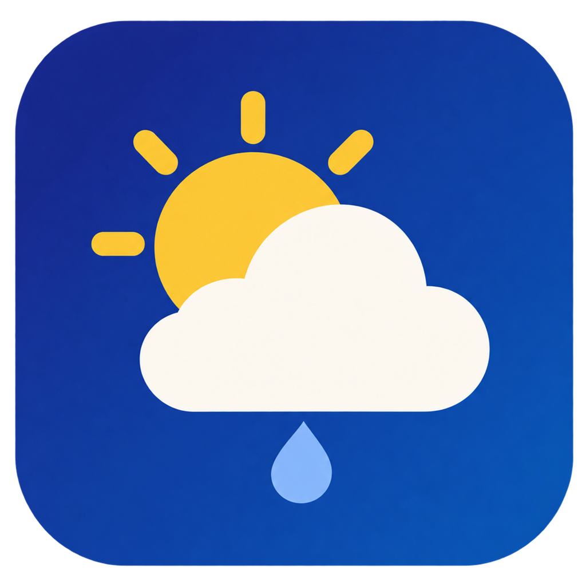
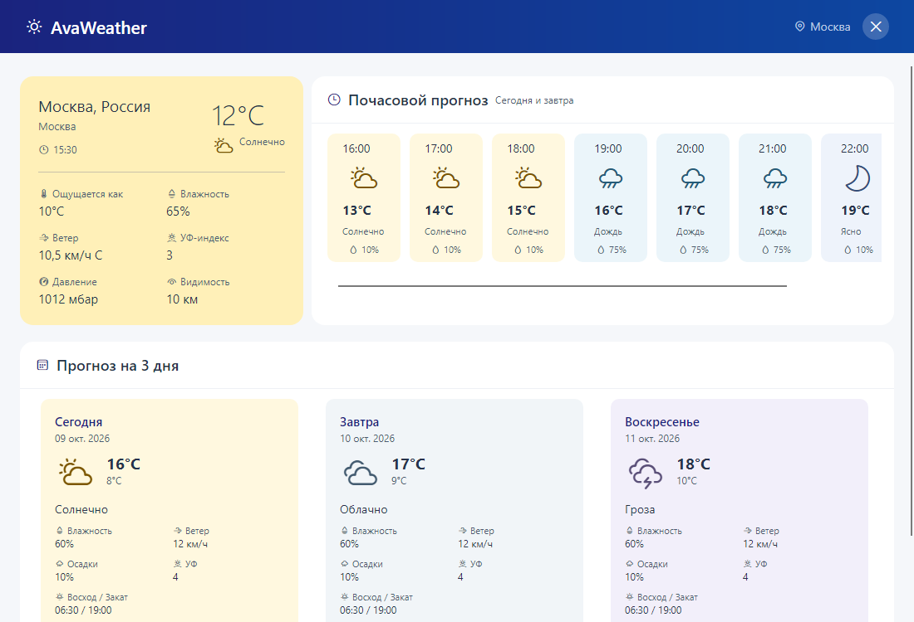

[](https://github.com/gagarinbefree/AvaWeather/actions/workflows/dotnet-tests.yml)
[](https://dotnet.microsoft.com/)
[](https://avaloniaui.net/)
[](https://docs.avaloniaui.net/docs/deployment/webassembly)
[](https://learn.microsoft.com/dotnet/communitytoolkit/mvvm/)
[](https://www.weatherapi.com/)

# AvaWeather



Кроссплатформенное погодное приложение на .NET 10 и Avalonia. Есть настольные версии для Windows, Linux и macOS, веб-версия и проект приложения для Android.

**Последняя версия:** <!-- release-version -->v1.0.84<!-- /release-version -->

**Веб-версия:** [Открыть AvaWeather](https://gagarinbefree.github.io/AvaWeather/). Сайт показывает ту же погоду и трёхдневный прогноз, автоматически определяя местоположение. Его можно установить как PWA через меню браузера; после первого посещения при отсутствии сети открывается страница с сообщением, а для актуального прогноза нужен интернет. Сайт собирается из `AvaWeather.Browser` на Avalonia WebAssembly после тестов и публикуется в GitHub Pages.

О приложении на сайте: [по-русски](https://gagarinbefree.github.io/AvaWeather/ru/about.html) · [in English](https://gagarinbefree.github.io/AvaWeather/about.html).

Инструкции по установке: [по-русски](https://gagarinbefree.github.io/AvaWeather/ru/install.html) · [in English](https://gagarinbefree.github.io/AvaWeather/install.html).

[Карта сайта для поисковых сервисов](https://gagarinbefree.github.io/AvaWeather/sitemap.xml).

### SEO и индексация сайта

Веб-приложение Avalonia рисует прогноз на canvas, поэтому для поисковых систем созданы отдельные HTML-страницы о приложении [на русском](https://gagarinbefree.github.io/AvaWeather/ru/about.html) и [на английском](https://gagarinbefree.github.io/AvaWeather/about.html), а также страницы установки для Windows, macOS и Linux на обоих языках. Страницы о приложении содержат описание возможностей и снимок интерфейса; страницы установки — инструкции и ссылки на актуальные сборки. Языковые версии связаны атрибутами `hreflang`, имеют собственные `canonical`-адреса и перечислены в `sitemap.xml`. Главная страница также содержит описание приложения до загрузки WebAssembly и прямую ссылку на русскую страницу. Персональный прогноз определяется по IP при открытии сайта и не является отдельной индексируемой страницей города.

Сайт с адресом `https://gagarinbefree.github.io/AvaWeather/` подтверждён в Google Search Console как свойство **URL-prefix**. Файл [подтверждения владения](https://gagarinbefree.github.io/AvaWeather/google4c6e30926229c0e5.html) включён в публикацию GitHub Pages. [Карта сайта](https://gagarinbefree.github.io/AvaWeather/sitemap.xml) содержит главную и четыре информационные страницы.

## Скачать

| Платформа | Автономный файл | Установщик |
|-----------|----------------|------------|
| Windows x64 | [AvaWeather-win-x64.exe](https://github.com/gagarinbefree/AvaWeather/releases/latest/download/AvaWeather-win-x64.exe) | [AvaWeather-setup-win-x64.exe](https://github.com/gagarinbefree/AvaWeather/releases/latest/download/AvaWeather-setup-win-x64.exe) |
| Windows ARM64 | [AvaWeather-win-arm64.exe](https://github.com/gagarinbefree/AvaWeather/releases/latest/download/AvaWeather-win-arm64.exe) | [AvaWeather-setup-win-arm64.exe](https://github.com/gagarinbefree/AvaWeather/releases/latest/download/AvaWeather-setup-win-arm64.exe) |
| Linux x64 | [AvaWeather-linux-x64.tar.gz](https://github.com/gagarinbefree/AvaWeather/releases/latest/download/AvaWeather-linux-x64.tar.gz) | — |
| Linux ARM64 | [AvaWeather-linux-arm64.tar.gz](https://github.com/gagarinbefree/AvaWeather/releases/latest/download/AvaWeather-linux-arm64.tar.gz) | — |
| macOS Intel | [AvaWeather-osx-x64](https://github.com/gagarinbefree/AvaWeather/releases/latest/download/AvaWeather-osx-x64) | [AvaWeather-setup-osx-x64.pkg](https://github.com/gagarinbefree/AvaWeather/releases/latest/download/AvaWeather-setup-osx-x64.pkg) |
| macOS Apple Silicon | [AvaWeather-osx-arm64](https://github.com/gagarinbefree/AvaWeather/releases/latest/download/AvaWeather-osx-arm64) | [AvaWeather-setup-osx-arm64.pkg](https://github.com/gagarinbefree/AvaWeather/releases/latest/download/AvaWeather-setup-osx-arm64.pkg) |
| Android | [AvaWeather-android.apk](https://github.com/gagarinbefree/AvaWeather/releases/latest/download/AvaWeather-android.apk) | — |

Установщик Windows добавляет приложение в меню «Пуск», при желании создаёт ярлык на рабочем столе и регистрирует удаление в настройках Windows. Пакет macOS устанавливает `AvaWeather.app` с иконкой в `/Applications`. Оба установщика содержат то же автономное приложение, что доступно отдельным файлом. Установщики приложения пока не подписаны доверенными сертификатами; Windows и macOS могут запросить подтверждение запуска.

### Системные виджеты Windows 11 и macOS

| Платформа | Установщик виджета |
|-----------|---------------------|
| Windows 11 x64 | [AvaWeather-widget-setup-win-x64.exe](https://github.com/gagarinbefree/AvaWeather/releases/latest/download/AvaWeather-widget-setup-win-x64.exe) |
| Windows 11 ARM64 | [AvaWeather-widget-setup-win-arm64.exe](https://github.com/gagarinbefree/AvaWeather/releases/latest/download/AvaWeather-widget-setup-win-arm64.exe) |
| macOS Intel | [AvaWeather-widget-osx-x64.zip](https://github.com/gagarinbefree/AvaWeather/releases/latest/download/AvaWeather-widget-osx-x64.zip) |
| macOS Apple Silicon | [AvaWeather-widget-osx-arm64.zip](https://github.com/gagarinbefree/AvaWeather/releases/latest/download/AvaWeather-widget-osx-arm64.zip) |

Виджеты собираются отдельно от автономного приложения: системные панели требуют пакет MSIX в Windows и расширение WidgetKit внутри `.app` в macOS. Linux-пакеты виджетов не выпускаются. Виджет обновляет погоду самостоятельно, когда окно приложения закрыто, выбирает язык по стране, определённой через IP, и получает погоду из WeatherAPI.

Установщик Windows содержит `.msix` и публичный сертификат подписи внутри одного `.exe`. Он показывает отпечаток сертификата, проверяет целостность вложенных файлов и подпись пакета, затем запрашивает разрешение администратора, чтобы добавить сертификат в **Доверенные лица локального компьютера**, и устанавливает виджет для текущего пользователя. После этого добавьте AvaWeather в панели виджетов Windows. Сам установщик подписан тем же сертификатом для разработки; до первого доверия Windows может показать предупреждение о неизвестном издателе. Отдельные [MSIX x64](https://github.com/gagarinbefree/AvaWeather/releases/latest/download/AvaWeather-widget-win-x64.msix), [MSIX ARM64](https://github.com/gagarinbefree/AvaWeather/releases/latest/download/AvaWeather-widget-win-arm64.msix), [CER x64](https://github.com/gagarinbefree/AvaWeather/releases/latest/download/AvaWeather-widget-win-x64.cer) и [CER ARM64](https://github.com/gagarinbefree/AvaWeather/releases/latest/download/AvaWeather-widget-win-arm64.cer) доступны для ручной установки. Для неё сертификат нужно импортировать в хранилище **Доверенные лица локального компьютера** с правами администратора.

Сертификат для разработки создаётся заново для каждого релиза и остаётся в хранилище после удаления виджета; его можно удалить вручную по показанному отпечатку. Для распространения без такого доверия нужна подпись от доверенного издателя или публикация через Microsoft Store.

На macOS распакуйте `.zip`, перенесите `AvaWeatherWidgetHost.app` в Applications и запустите его один раз. Затем добавьте AvaWeather на рабочий стол или в Центр уведомлений через галерею виджетов. Пакет подписан локальной подписью без Apple Developer ID; macOS может попросить подтвердить первый запуск в настройках безопасности. Для распространения без этого шага понадобятся Apple Developer ID и notarization.

Автономные файлы остаются доступны для всех платформ. Windows сборка — самодостаточный `.exe`; архив Linux содержит один самодостаточный исполняемый файл `AvaWeather`; macOS сборка скачивается непосредственно как самодостаточный исполняемый файл. .NET Runtime устанавливать не нужно. На Linux распакуйте архив и запустите `./AvaWeather`. На macOS для отдельного файла выполните `chmod +x AvaWeather-osx-arm64 && ./AvaWeather-osx-arm64` (для Intel замените `arm64` на `x64`). Установщик macOS добавляет приложение с иконкой в Finder и Dock.

## О проекте

Приложение автоматически определяет приблизительную локацию по IP через GeoJS и получает погоду для её координат из WeatherAPI. Если GeoJS недоступен, WeatherAPI определяет местоположение по IP:

- **Текущая погода** - температура, ощущается как, влажность, ветер, УФ-индекс, давление и видимость.
- **Почасовой прогноз** - оставшиеся часы сегодняшнего дня и следующий день по времени города.
- **Прогноз на 3 дня** - максимальная и минимальная температура, осадки, влажность, ветер и время восхода и заката.

### Особенности

- ✅ MVVM и генераторы свойств и команд CommunityToolkit.Mvvm.
- ✅ Compiled bindings и C# разметка `Avalonia.Markup.Declarative`.
- ✅ View Locator и Dependency Injection.
- ✅ Автоматический выбор русского или английского языка по стране, определённой через IP; перевод подписей, ошибок, дат, единиц измерения и описаний погоды.
- ✅ Перестроение карточек при изменении ширины окна.
- ✅ Обработка сетевой ошибки с кнопкой Retry.
- ✅ Тесты
- ✅ Готовые погодные и интерфейсные иконки Fluent UI без собственных SVG-путей и Unicode-пиктограмм.
- ✅ Собственная иконка приложения для окна, Windows `.exe` и Dock на macOS.
- ✅ Мягкие цвета карточек и иконок меняются по погоде каждого периода: солнце, облака, дождь, снег, туман, гроза и ночь.

## Технологии

| Технология | Версия |
|------------|--------|
| .NET | 10.0 |
| Avalonia | 12.1.3 |
| Avalonia.Markup.Declarative | 12.1.1 |
| CommunityToolkit.Mvvm | 8.4.2 |
| Svg.Controls.Skia.Avalonia | 12.0.0.17 |
| MediatR | 14.2.0 |
| AutoMapper | 16.2.0 |

## Язык интерфейса

После определения страны приложение включает русский язык для России, Украины, Беларуси, Казахстана, Кыргызстана, Узбекистана, Таджикистана, Туркменистана, Молдовы, Армении, Азербайджана, Грузии, Эстонии, Латвии и Литвы. Для остальных стран и при недоступной геолокации используется английский. Выбор не зависит от языка операционной системы и не требует ручной настройки.

Подписи интерфейса и сообщения ошибок хранятся в `Localization/*.resx`; C# получает их через `StringLocalizer` по имени. Для macOS сборка экспортирует те же переводы в `.strings` через `tools/export_swift_localization.py`. WeatherAPI возвращает описания погодных условий на выбранном языке. Соответствие кодов погоды и иконок Fluent UI хранится в `SharedAssets/Weather/weather-conditions.json` и используется общим каталогом `Application.Weather.WeatherConditionCatalog`. Единственный исходный файл цветов интерфейса и погодных карточек — `SharedAssets/Themes/default.json`; общий `ThemeColorService` возвращает цвет по имени сайту, Avalonia-приложению и Windows-виджету. Из него же при сборке создаётся ресурс для виджета macOS. Для русского интерфейса приложение отдельно уточняет русское название города и региона по координатам. Если сервис названий недоступен, прогноз продолжает работать с исходным названием.

Данные о погоде: [WeatherAPI](https://www.weatherapi.com/). Геолокация: [GeoJS](https://www.geojs.io/docs/v1/endpoints/geo/); названия мест основаны на [GeoNames](https://www.geonames.org/) ([CC BY 4.0](https://creativecommons.org/licenses/by/4.0/)).

## Установка и запуск

Требуется [.NET 10 SDK](https://dotnet.microsoft.com/download/dotnet/10.0). Для погоды нужен ключ [WeatherAPI](https://www.weatherapi.com/). На Windows, macOS или Linux:

1. Скопируйте `AvaWeather/appsettings.example.json` в `AvaWeather/appsettings.json` и укажите `WeatherApi.ApiKey` либо установите переменную окружения `WEATHER_API_KEY`.
2. Запустите приложение:

```sh
dotnet run --project AvaWeather/AvaWeather.csproj
```

Локальный `appsettings.json` исключён из Git и не входит в публикуемый исполняемый файл. Значение `WeatherApi.DefaultLocation` по умолчанию — `auto:ip`; оно используется, если GeoJS недоступен. Если GeoJS определил координаты, WeatherAPI получает их явно. Запрос прогноза использует координаты из ответа текущей погоды, поэтому оба ответа относятся к одному месту. Адрес API и число дней прогноза также настраиваются в этом файле. Для готового релиза ключ WeatherAPI встроен при сборке; при необходимости его можно переопределить переменной окружения `WEATHER_API_KEY`.

Для локального запуска сайта установите .NET 10 SDK и `dotnet workload install wasm-tools`, создайте `AvaWeather.Browser/wwwroot/appsettings.Development.json` с содержимым `{ "WeatherApi": { "ApiKey": "ваш-ключ" } }` и выполните `dotnet run --project AvaWeather.Browser/AvaWeather.Browser.csproj`. Этот файл исключён из Git и из опубликованного сайта. При публикации GitHub Actions берёт ключ из секрета `WEATHER_API_KEY`.

### Android

Установите .NET 10 SDK, Android SDK, JDK 17 и нагрузку `dotnet workload install android`. Для запуска через F5 в Visual Studio установите рабочий набор **Разработка пользовательского интерфейса многоплатформенных приложений .NET** и отдельный компонент **Android SDK setup** во вкладке **Отдельные компоненты**. `.vsconfig` в корне решения перечисляет оба пункта и предложит установить недостающие. Если SDK и JDK установлены в нестандартные каталоги, создайте игнорируемый Git файл `AvaWeather.Android/Android.Local.props` с путями `AndroidSdkDirectory` и `JavaSdkDirectory`. Скопируйте `AvaWeather.Android/appsettings.Development.example.json` в `AvaWeather.Android/appsettings.Development.json` и укажите свой ключ WeatherAPI. Этот файл включается только в Debug-сборку и исключён из Git. Откройте полное решение `AvaWeather.sln` в Visual Studio: фильтр `AvaWeather.DesktopWeb.slnf` исключает Android. Назначьте `AvaWeather.Android` запускаемым проектом, выберите эмулятор и нажмите F5. В Debug-сборке журнал запросов сохраняется во внутреннем каталоге приложения в `logs/api-access.log`; Release-сборка файл не создаёт. Локация определяется по IP, поэтому разрешение на GPS не требуется. Интерфейс, локализация и погодные сервисы используются совместно с настольной и веб-версиями.

Для подписи APK в GitHub Actions уже настроены секреты `ANDROID_KEYSTORE_BASE64` и `ANDROID_KEYSTORE_PASSWORD`. Храните исходный keystore и пароль отдельно: для обновлений Android нужна та же подпись. Успешная сборка основной ветки помещает APK в GitHub Release рядом с настольными файлами. Ключ WeatherAPI берётся из существующего секрета `WEATHER_API_KEY` и встраивается в APK при публикации.

## Тесты

Для сборки всего решения нужны .NET 10 SDK, нагрузки `wasm-tools` и `android`, Android SDK и JDK 17. Если Android SDK пока не установлен, используйте фильтр решения для настольной и веб-версий и запускайте тестовый проект отдельно:

```sh
dotnet build AvaWeather.DesktopWeb.slnf
dotnet test AvaWeather.Tests/AvaWeather.Tests.csproj
```

GitHub Actions запускает тесты при каждом push и pull request в `master` или `main`, проверяет сборку Android-проекта и сохраняет TRX-отчёт. После успешных тестов основной ветки он собирает шесть автономных файлов, четыре установщика приложения и четыре пакета виджетов, создаёт GitHub Release, увеличивает версию `1.0.N` и обновляет её в README. При наличии секретов подписи к релизу добавляется Android APK. Ссылки выше всегда ведут к последнему релизу. Установщик Windows проверяется пробной установкой, сравнением исполняемого файла и удалением; пакет macOS проверяется после распаковки вместе с подписью приложения. Тесты проверяют загрузку, повтор после ошибки, защиту от параллельных запросов, фильтрацию часов по времени города, модель и содержимое виджета и отрисовку карточек в широком и узком окне. Для сохранения снимков headless-интерфейса задайте `AVAWEATHER_SCREENSHOT` и `AVAWEATHER_NARROW_SCREENSHOT` с путями к PNG.

Коммиты от `github-actions[bot]` создаёт сам GitHub Actions после выпуска релиза: он записывает новую версию в README. Пометка `[skip ci]` в сообщении такого коммита не запускает повторную сборку из-за обновления README.

Для публикации в настройках репозитория GitHub → **Settings → Secrets and variables → Actions** нужен секрет `WEATHER_API_KEY`. После тестов сборка проверяет этот ключ запросами текущей погоды и трёхдневного прогноза; сам ключ в журнал не выводится. Затем сборка шифрует ключ AES-GCM и встраивает зашифрованные байты в настольное приложение и подписанный Android APK. Ключ расшифровки тоже находится в пакетах, так как приложения работают автономно; это скрывает ключ от простого поиска строк, но не защищает его от извлечения. Для настоящей защиты ключ должен оставаться на сервере-посреднике.

Для статического сайта GitHub Actions записывает `WEATHER_API_KEY` в опубликованный `appsettings.json`. Этот файл доступен посетителям сайта: ключ в браузере не скрыт.

## Устройство

- `Domain` и `Application` - модель погоды, сценарий получения прогноза, интерфейсы сервисов и преобразование данных.
- `Infrastructure` - общие HTTP-клиенты WeatherAPI, GeoJS и геокодирования, получение ключа WeatherAPI, журнал сетевых запросов в Debug и регистрация сервисов в DI. Настольные сборки включают резервное прямое подключение; браузерная сборка использует стандартный `HttpClient`.
- `AvaWeather.Browser` - статический сайт Avalonia WebAssembly для GitHub Pages.
- `AvaWeather.Android` - приложение Android с общим экраном Avalonia, MVVM-моделью и сервисами погоды.
- `AvaWeather.UI/ViewModels` - общая MVVM-модель экрана на генераторах CommunityToolkit.Mvvm.
- `AvaWeather.UI/Views` - общий интерфейс настольного приложения, Android и сайта на C# и `Avalonia.Markup.Declarative`; связи с данными созданы через `CompiledBinding`.
- `ViewLocator` - явное соответствие модели экрана и представления, создаваемого контейнером DI.

Общие SVG-иконки сайта и Avalonia-приложений лежат в `SharedAssets/Icons`. Они взяты из набора [Fluent UI System Icons](https://github.com/microsoft/fluentui-system-icons) под лицензией MIT. При сборке те же файлы встраиваются в `AvaWeather.UI` и используются сайтом, Android и настольным приложением без загрузки иконок из сети. Исходный рисунок и готовые форматы иконки приложения лежат в `SharedAssets/Branding` и используются настольным приложением, Android, сайтом, установщиками и виджетами.

Для собственной автономной сборки используйте `dotnet publish AvaWeather/AvaWeather.csproj -c Release -r linux-x64 --self-contained true -p:PublishSingleFile=true -p:IncludeNativeLibrariesForSelfExtract=true` (или другой RID из таблицы). Для погоды укажите свой ключ через `WEATHER_API_KEY` либо локальный `appsettings.json`.


